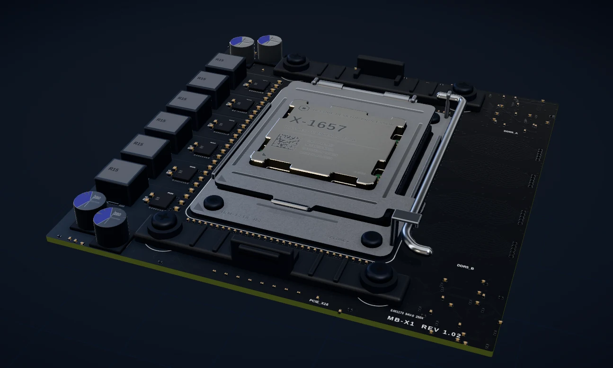
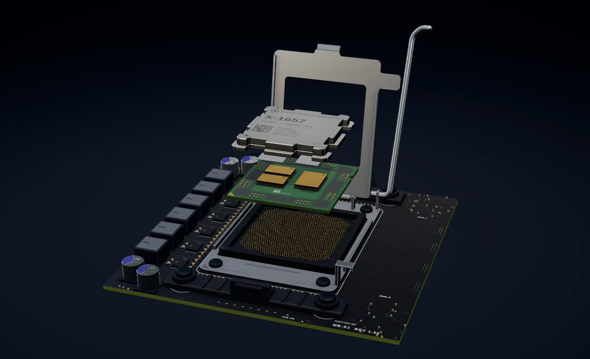

  <picture>
    <source media="(prefers-color-scheme: dark)" srcset="docs/logo-dark.svg">
    
  </picture>

<a href="https://visualiz3r.vercel.app"><b>visualiz3r.vercel.app</b></a>

  
  
  

---

**visualiz3r** lets you look inside the machines we use every day, in 3D, right in your browser.

**Hardware** — Take apart a graphics card, a processor, a memory stick, an SSD, a hard drive and a Raspberry Pi. Rotate them, pull them apart layer by layer, and click any part to learn what it does — all the way down to the silicon.

**Language model** — Watch a real (tiny) AI language model run in your browser. Type a sentence and follow it through every step as the model predicts the next word, with a guided tour that explains each part.

  
  

## License

© 2026 Jordan Bailey. All rights reserved. The code is public to view, not to reuse — see [LICENSE](LICENSE).
