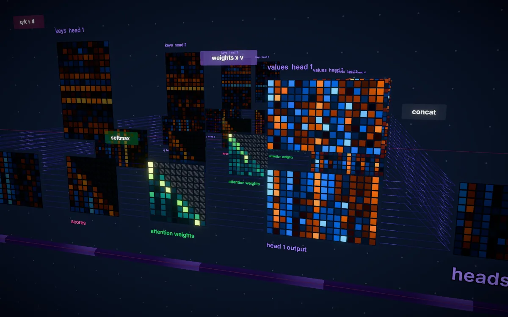

# Inside the Machine

Interactive 3D explainers for curious people:

- **Hardware lab** — realistic, explodable models of a graphics card, a desktop
  processor, a DDR5 memory module, an NVMe SSD, a hard disk drive and a
  Raspberry Pi 5. Drag to rotate, scroll to zoom, click any part to learn what it
  does (double-click to fly to it), and pull the slider to take the device apart
  layer by layer — down to floorplans of the silicon dies.
- **How an LLM works** — a real (tiny) transformer language model running in
  your browser. Every tensor of the forward pass is laid out in 3D with its
  actual values: tokens, embeddings, attention heads, MLPs, the residual stream
  and the next-token probabilities. A guided tour walks through each step, and
  clicking any cell shows exactly how that number was computed.



The interface is an instrument panel that stays out of the way: the home screen
is just two dials, and in the explorers every panel is summoned — **C** opens
the component tree, **I** the unit brief, **T** the guided tour (LLM), clicking
a part opens its readout, and **H** hides everything for a clean view.

## Running it

```bash
npm install
npm run dev
```

Open http://localhost:4173 (the dev script binds `0.0.0.0:4173`). For a
production build: `npm run build && npm start`.

Checks:

```bash
npm run typecheck
npm test            # tokenizer/model parity with PyTorch + visualisation invariants
npm run smoke       # every route in headless Chromium: no errors, explode, zoom-to-part
```

`npm run smoke` and the screenshot script expect a dev server on port 4174
(`npx next dev --port 4174`, or pass `--base http://localhost:4173`).

## How it's built

Next.js 16 (App Router, Turbopack), React 19, three.js via React Three Fiber,
drei and `@react-three/postprocessing`, Zustand for state, Tailwind CSS 4.

```
app/                     routes: / , /hardware , /hardware/[device] , /llm
components/hud/          interface kit: dials, panels, selector, lamps, readout sections
components/hardware/     hardware explorer (canvas, UI, part system)
  kit/                   reusable procedural parts: PCBs, chips, passives, connectors, fans, heat pipes…
  models/<device>/       one folder per device model
components/llm/          LLM explorer (scene + UI)
lib/hardware/            device catalog, explanations for every part, explorer store
lib/llm/                 tokenizer + inference engine (pure TypeScript, no dependencies)
lib/llm/viz/             layout, colour maps, explanations, guided tour, store
lib/three/               canvas painter for procedural textures, PCB and die-shot painters,
                         camera fitting, panel-aware view shift, hit filtering, HDR clamp
scripts/llm/             data prep, tokenizer and model training (PyTorch), export, fixtures
scripts/screenshot.mjs   headless screenshots for visual checks
scripts/smoke.mjs        end-to-end smoke test of every route
public/llm/              the trained model (model.json, model.bin, tokenizer.json)
public/previews/dial/    square renders shown inside the home and unit-select dials
```

### Hardware models

Every model is procedural geometry — no downloaded meshes or photos. Boards are
painted at runtime into colour / roughness-metalness / bump maps (traces, vias,
BGA land patterns, silkscreen), chips carry etched markings, and shared
physically based materials, studio lighting, ambient occlusion and outlines give
them a product-shot look. See [components/hardware/README.md](components/hardware/README.md)
for how parts, explode animations and explanations fit together.

Dimensions follow real hardware; part layouts are faithful reconstructions but
not manufacturer CAD. Die floorplans are illustrative of the real organisation
(clusters, cores, caches, PHYs), not literal photographs. Markings are generic.

### The language model

A Llama-style decoder (RMSNorm, rotary positions, SwiGLU, tied embeddings):
4 blocks, width 64, 4 heads, 2,048-token byte-level BPE vocabulary — 393,792
parameters, trained on TinyStories for ~9 minutes on one GPU (validation loss
1.93 nats/token). The TypeScript engine in `lib/llm` reproduces the PyTorch
reference to within 1e-5 and records every intermediate tensor for the
visualisation. To retrain or swap in a bigger model, see
[scripts/llm/README.md](scripts/llm/README.md) — the visualisation lays itself
out from the model config.

## Visual checks

With a dev server on port 4174:

```bash
node scripts/screenshot.mjs /llm .screenshots/llm.png --wait 8000 \
  --eval "window.__llm.getState().setTour(8)" --then-wait 3000
```

In development `window.__explorer` / `window.__llm` expose the stores and
`window.__three` the React Three Fiber state.
